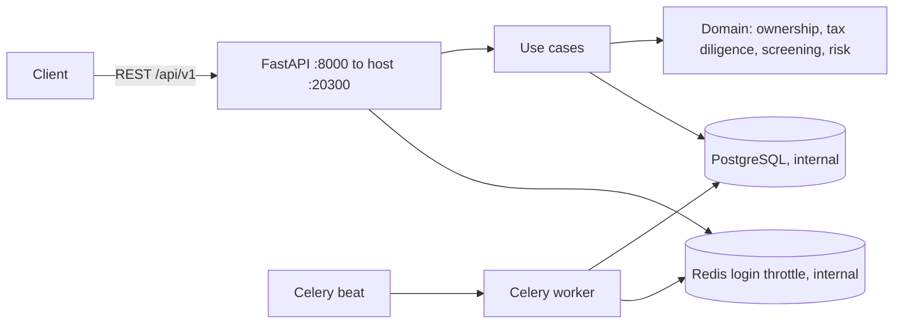

# CounterpartyDD

Counterparty due diligence under Russian law: ownership traced through to beneficial owners under 115-ФЗ, tax due-diligence facts under ст. 54.1 НК РФ, watchlist screening of related persons, and a dossier that ends in a compliance officer's decision. Every action is written to a hash-chained audit log.

---

## What this is

A counterparty check is often reduced to an EGRUL extract and a score with no legal logic. Three mistakes follow.

- The beneficial owner is taken from the direct share. Indirect chains, cross-holdings, nominees, and control without a share are lost. The threshold is applied as "25% or more", while the statute requires "more than 25 percent".
- Facts that the statute says are not a ground on their own (signature by an unauthorised person, the counterparty's own violations, a "shell" label) are treated as decisive. Signs that the transaction was unreal are not separated from background.
- The same person who ran the check approves it. The dossier is incomplete, and the history of edits is unprotected.

CounterpartyDD is the check:

- **Ownership graph with exact arithmetic.** Shares are stored as `Fraction`, so rounding does not accumulate. The integrated share is the solution of `(I − A)·x = a`, so cross-holdings and cycles are handled. A closed cycle with no external owner is rejected as an impossible structure.
- **Beneficial owners under 115-ФЗ.** A natural person is a beneficial owner if they own strictly more than 25% or control the client. Nominees are looked through to the principal. The exceptions in подп. 2 п. 1 ст. 7 are set explicitly. If no beneficial owner is identified, the sole executive body may be recognised as one (flagged "requires a decision"). If more than 25% of capital is not traced to natural persons, an opacity flag is set. Ownership paths are stored for each beneficial owner.
- **Due diligence under ст. 54.1 НК РФ.** A catalogue of 22 circumstances in five classes: breach of the conditions in ст. 54.1, signs the transaction was unreal (п. 5 Пленума ВАС № 53), registry signals (129-ФЗ, КоАП РФ), circumstances that are not a ground on their own (п. 3 ст. 54.1), and contextual facts (п. 6 Пленума № 53). The verdict is monotonic: adding facts never lowers it. A set of only "weak" circumstances never yields HIGH; property tests lock that in. Registry facts are derived automatically: an unreliability record, the six-month rule, a decision on forthcoming exclusion, a disqualified director.
- **Watchlist screening.** Names and legal names are normalised: transliteration, legal-form tokens dropped, a symmetric similarity measure. An INN/OGRN match scores 1.0; a birth-date mismatch lowers the score. The profile, related persons, and every graph node are screened. A confirmed hit on a terrorism and extremism list, or on a sanctions list, for any owner or controlling person higher in the chain forces the risk to CRITICAL (п. 2 ст. 6 115-ФЗ).
- **Risk score.** Six weighted factors and forced overrides. Residual risk falls as remediation tasks are closed, and by no more than 30%.
- **Process.** A status model for the check, dossier completeness (mandatory and recommended items), four eyes (the person who ran the check does not decide), and refusal or conditional approval only with a rationale. A commission pack carries a SHA-256 of the evidence bundle. Monitoring uses a review period by risk level: Celery beat re-runs screening and, on a new alert, returns the check for review.
- **Security.** PASETO v4.local, as in the rest of the portfolio; the token type is bound with an implicit assertion. bcrypt. Login attempts are limited in Redis (5 in 15 minutes). Tenant isolation: `tenant_id`, the performer, and the author of the decision are taken only from the token. Roles: `ADMIN`, `COMPLIANCE_OFFICER`, `ANALYST`, `AUDITOR`. An HMAC audit chain per tenant, written under `pg_advisory_xact_lock`, with an integrity endpoint.

The project meets two other portfolio repositories only on the theme of third-party risk. There is no shared code beyond the template layer (settings, logging, PASETO, Celery).

- ProcurementHub (44-ФЗ / 223-ФЗ) stores a procurement participant's profile and scores contract-performance risk. CounterpartyDD adds the ownership graph, beneficial owners, and screening. In combination, the counterparty is checked first, then the procurement and performance are run.
- PD-Processor-Registry scores personal-data processors under 152-ФЗ. That is a different subject (a processing assignment), not tax and AML risk.

---

## Architecture at a glance

```
src/counterparty_dd/
  domain/          pure rules, no I/O: ownership, tax_diligence, screening, risk, policy, identifiers, names
  application/     use cases: UnitOfWork, checks, counterparties, graph, screening, art. 54.1, decisions, monitoring, audit
  infrastructure/  SQLAlchemy 2 async (19 tables, JSONB on PostgreSQL), Redis throttle, Celery worker, container
  api/             FastAPI, 54 operations under /api/v1, domain-error handler
migrations/        Alembic (async), initial schema; alembic check is clean
scripts/           seed_demo.py — fictitious data with valid INN/OGRN checksums
tests/             unit (hypothesis), api (SQLite), integration (PostgreSQL + Redis)
```



Stack: Python 3.13, FastAPI 0.143, Pydantic 2.14, SQLAlchemy 2.1 + asyncpg, Alembic 1.20, Celery 5.6, Redis 6.x (client), pyseto 1.10, bcrypt 5, structlog, pytest 9, hypothesis, ruff.

Services: `postgres`, `redis`, `migrate` (one-shot `alembic upgrade head`), `api`, `worker` (Celery with beat, flag `-B`; the monitoring task runs once an hour).

---

## Quick start

Requirements: Docker, Docker Compose v2, make, curl.

```bash
git clone <repo-url> CounterpartyDD && cd CounterpartyDD
make setup
```

One command creates `.env` (secrets are generated), builds the images (a multi-stage build on `uv`), starts the stack, applies migrations, and waits for health.

| What | URL |
|---|---|
| API | http://127.0.0.1:20300 |
| Docs | http://127.0.0.1:20300/docs |
| Health | http://127.0.0.1:20300/api/v1/health |

Demo data: `make seed`.

| Email | Role |
|---|---|
| `admin@demo-cdd.ru` | `ADMIN` |
| `compliance_officer@demo-cdd.ru` | `COMPLIANCE_OFFICER` |
| `analyst@demo-cdd.ru` | `ANALYST` |
| `auditor@demo-cdd.ru` | `AUDITOR` |

The password is `CDD_DEMO_PASSWORD` when that variable is set, otherwise the seed default `demo-password-2026`. The script prints the case number and the `*@demo-cdd.ru` pattern.

On the host, without containers (`uv` required): `make local-install`, `make local-test`, `make local-lint`.

---

## Non-standard ports (intentional)

Host ports sit in the `203xx` block and bind to `127.0.0.1` only. Override them with `*_HOST_PORT` in `.env` (see `.env.example`).

| Service | Variable | Host port | Container | Published by default? |
|---|---|---|---|---|
| API | `API_HOST_PORT` | **20300** | 8000 | yes |
| PostgreSQL | `POSTGRES_HOST_PORT` | **20301** | 5432 | no — `docker-compose.debug.yml` |
| Redis | `REDIS_HOST_PORT` | **20302** | 6379 | no — `docker-compose.debug.yml` |

Postgres and Redis stay on the Compose network unless you publish them for debugging:

```bash
docker compose -f docker-compose.yml -f docker-compose.debug.yml up -d
```

---

## Make targets

`make help` prints the list.

| Target | What it does |
|---|---|
| `setup` | Full install in one command: deps, `.env`, free ports, build, up, wait, migrate, print URLs |
| `check-deps` | Require Docker and Docker Compose v2 |
| `env` | Create `.env` from `.env.example` if missing, and generate secrets |
| `check-ports` | Fail if a host port is already taken |
| `build` | Build images |
| `up` | Start the stack in the background |
| `wait` | Wait until the API health check answers |
| `migrate` | `alembic upgrade head` |
| `urls` | Print addresses |
| `down` | Stop the stack; volumes stay |
| `logs` | Follow logs (`make logs s=api`) |
| `ps` | Service status |
| `test` | Unit, API, and integration tests in a container against Postgres and Redis |
| `lint` | `ruff check` and `ruff format --check` |
| `fmt` | `ruff format` and `ruff check --fix` |
| `shell` | Shell in the API container |
| `worker` | Follow the Celery worker logs (worker + beat) |
| `seed` | Load demo data |
| `check-migrations` | `alembic check` |
| `clean` | Stop and remove this project's containers, volumes, and images |
| `local-install` | `uv sync` on the host |
| `local-test` | `pytest` on the host |
| `local-lint` | `ruff` on the host |

---

## API overview

54 operations under `/api/v1`. Auth is `Authorization: Bearer` (PASETO v4.local). The full list is in `/docs`.

| Group | What it covers |
|---|---|
| `auth` | Login |
| `cases` | CRUD, transitions, completeness, commission pack, media, evidence |
| `counterparties` | Profile, registry particulars, related persons |
| `watchlists`, `screening` | Lists and screening runs |
| `ownership` | Nodes, edges, graph, analysis, beneficial owners |
| `tax-diligence` | ст. 54.1 facts and verdict |
| `risk` | Score and remediation tasks |
| `approvals` | Four-eyes decision |
| `monitoring` | Review schedule |
| `analytics` | Aggregates |
| `audit` | Event log and integrity check |

Roles: `ADMIN`, `COMPLIANCE_OFFICER`, `ANALYST`, `AUDITOR`. `tenant_id`, the performer, and the decision author come from the token.

---

## Testing

```bash
make test
make lint
```

Integration tests (`tests/integration`) run automatically inside the `test` container, where `CDD_TEST_DATABASE_URL` and `CDD_TEST_REDIS_URL` are set. Postgres creates the database `counterparty_dd_test` on first start. Outside the container those tests are skipped (`pytest.skip`) unless the variables are set.

Result at build time: 88 tests, 98% coverage with the integration tests (97% without them). `ruff check` and `ruff format --check` are clean.

The image is a multi-stage `uv` build and has been checked: `make setup` brings the stack up, health and `/docs` answer, and `make test` and `make lint` pass in containers on Postgres and Redis.

---

## Limitations

- There are no live integrations with EGRUL/FNS, Rosfinmonitoring, the register of disqualified persons, or sanctions lists. Lists are loaded by hand through the API; registry particulars are entered by an analyst. Demonstration lists and companies are fictitious.
- For an ordinary commercial organisation the counterparty check rests on ст. 54.1 НК РФ and the explanations on due diligence. The 115-ФЗ method is used as the standard for identifying a beneficial owner. The service does not replace the internal control of organisations that themselves fall under 115-ФЗ.
- Methodological choices, rather than statutory requirements, are: the control threshold through a chain (more than 50% at controlled persons), risk-factor weights, level thresholds, the residual-risk reduction for closed tasks, the escalation threshold of three contextual circumstances, and the review periods. All of them live in constants and settings.
- The high-risk country list is empty by default and is set with `CDD_HIGH_RISK_COUNTRIES`.
- A person approves. The service does not issue a legal opinion.

---

## Legal basis

Texts were checked against ConsultantPlus on 16.10.2026, in the editions then in force. Case law is not encoded in the rules: only the norms and explanations listed below are used.

**Federal Law of 07.08.2001 No. 115-ФЗ** (as amended by Federal Law of 04.08.2026 No. 283-ФЗ)

- Art. 3, definition of a beneficial owner: a natural person who ultimately, directly or indirectly (through third parties), owns the client legal entity (has a predominant participation of more than 25 percent in the capital) or is able to control the client's actions. From that wording the code uses a strict threshold `> 1/4` and a separate "control" ground.
- Subpara. 2 of para. 1 of art. 7, paragraphs 2–7: organisations for which beneficial-owner information is not established (public authorities and organisations with a state share of more than 50%, international organisations, religious organisations, issuers of securities admitted to organised trading, foreign listed companies, foreign structures without legal personality that have neither a beneficial owner nor a sole executive body). Paragraph 8: if a beneficial owner is not identified, the sole executive body of the client may be recognised as the beneficial owner.
- Art. 6.1: legal entities must hold information on their beneficial owners and update it regularly, at least once a year or when the information changes, and record the information obtained; the information is kept for at least five years from the day it was received.
- Para. 2 of art. 6 (as amended by Federal Law of 28.06.2022 No. 219-ФЗ): the list also includes a legal entity directly or indirectly owned or controlled by such an organisation or natural person. That is the ground for "a hit higher in the chain → CRITICAL".

**Tax Code of the Russian Federation, ст. 54.1** (introduced by Federal Law of 18.07.2017 No. 163-ФЗ; Tax Code as amended by Federal Law of 04.08.2026 No. 292-ФЗ)

- Para. 1: a prohibition on reducing the tax base as a result of distorting information about the facts of economic life.
- Para. 2: conditions — the principal purpose of the transaction is not non-payment (incomplete payment) and/or offset (refund) of tax; the obligation was performed by a party to the contract or by a person to whom it was transferred by contract or by law.
- Para. 3: signature by an unidentified or unauthorised person, the counterparty's violations, and the possibility of obtaining the same result by another transaction cannot be treated as an independent ground.

**Resolution of the Plenum of the Supreme Commercial Court of 12.10.2006 No. 53**

- Para. 5: signs of an unjustified tax benefit, including the impossibility of the taxpayer actually carrying out the stated operations, and the absence of the conditions needed to achieve the results (no managerial or technical staff, fixed assets, production assets, warehouses, vehicles).
- Para. 6: circumstances that cannot on their own be a ground (creation shortly before the operation, interdependence, irregularity, past violations, a one-off character, operations away from the registered address, a single bank, transit payments, intermediaries).
- Para. 10: a tax benefit may be found unjustified if the taxpayer acted without due diligence and caution.

**Federal Law of 08.08.2001 No. 129-ФЗ** (as amended by Federal Law of 04.08.2026 No. 285-ФЗ)

- Para. 6 of art. 11: after a reliability check, a notice of unreliability is sent; if reliable information is not provided within thirty days, a record of unreliability is entered in EGRUL.
- Art. 21.1: para. 2 — a decision on forthcoming exclusion; subpara. "b" of para. 5 — exclusion where EGRUL contains information in respect of which an unreliability record has stood for more than six months from the day the record was made. The six months are calendar months, with the end moved to the last day of a short month.

**Code of Administrative Offences** (as amended by Federal Law of 04.08.2026 No. 295-ФЗ)

- Art. 3.11: disqualification for six months to three years.
- Art. 32.11: para. 2 — a person authorised to conclude a contract must request information on whether a natural person is disqualified from the body that keeps the register of disqualified persons; para. 3 — the register of disqualified persons.

---

## License

MIT — Copyright (c) 2026 Pavel (d1g-1t)
